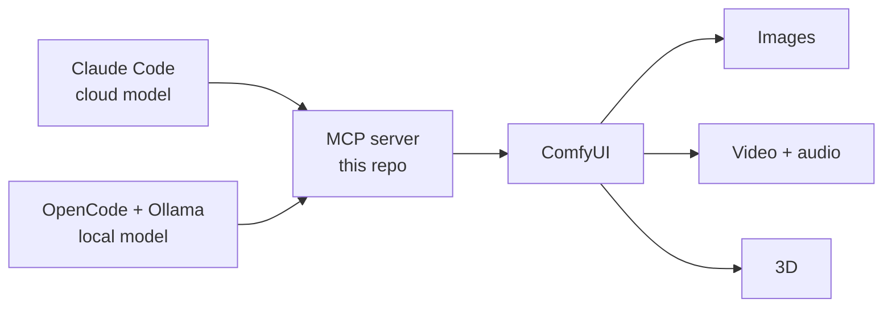
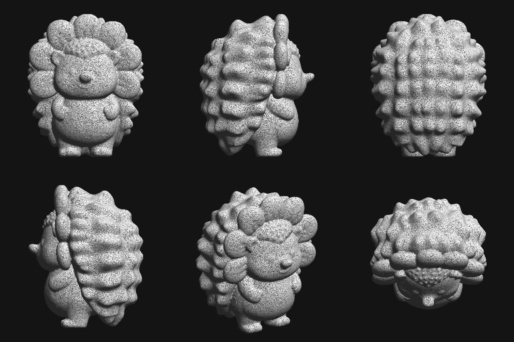

# Local AI Studio

Describe what you want in plain language, and your own machine makes it.


This repo is an [MCP](https://modelcontextprotocol.io) server that gives an AI agent access to local ComfyUI workflows for images, video with native audio, and 3D. The tools stay on your machine. The brain driving them is swappable: Claude Code with a cloud model, or OpenCode with a local model in Ollama.

It's provided as is, under the MIT license. There's no support team. Questions are welcome and may get answered when time allows.



## Examples

Larry, the test subject, made with these workflows.

| Text to image | Instruction edit |
|---|---|
|  |  |
| `qwen-lightning-8step` | `flux3-klein-edit` |

| Video with native audio | Printable 3D |
|---|---|
|  |  |
| `minimax-h3-i2v-fast` (GIF has no sound) | `hunyuan3d-image2mesh-hq` + `tools/mesh_to_solid.py` |

## What's here

| Path | What it is |
|---|---|
| `src/` | The MCP server |
| `workflows/` | ComfyUI API workflows |
| `workflow-metadata/` | What each workflow does and which parameters it takes |
| `agents/studio.md` | Rules for the local agent |
| `opencode.json` | OpenCode setup with the local agent |
| `.mcp.json` | Claude Code setup |
| `tools/mesh_to_solid.py` | Turns a 3D result into a watertight STL |
| `MODELS.md` | Model files each workflow family needs |

Voice and music aren't in this repo. The video uses Qwen3-TTS, VoxCPM2 and ACE-Step through their own MCP servers, and any MCP server can sit beside this one.

## Tested on

- Linux, NVIDIA card with 32 GB of VRAM, about 54 GB of RAM plus swap
- Node 22, Ollama 0.40.13, OpenCode 1.17.8
- Older Ollama versions may refuse the local model: 0.30.8 did

Other platforms and smaller cards are untested. Images and the local model used 29 GB of VRAM together here, and smaller setups may need smaller models. MiniMax H3 peaks around 44 GB of system RAM, so its workflows refuse to run on Linux without 18 GB of swap.

## Setup

1. Install [ComfyUI](https://github.com/comfyanonymous/ComfyUI) and start it on port 8188.
2. Install the model files you need from `MODELS.md`. The Hunyuan3D workflows also need the ComfyUI-RMBG custom node.
3. Build the server:

```bash
npm ci
npm run build
```

4. Tell the server where ComfyUI lives:

```bash
export COMFYUI_PATH=/path/to/ComfyUI
```

## Run with Claude Code

Start `claude` in this folder and approve the `comfy` server. Then ask:

> Make a picture of a sunflower hedgehog.

To let Claude reach every workflow, including video and 3D, start it with:

```bash
COMFY_MCP_ALLOW='*' claude
```

## Run with a local brain

```bash
ollama pull bonsai-2:27b
opencode run "Make a picture of a sunflower hedgehog." < /dev/null
```

Use OpenCode's terminal interface by running `opencode` with no arguments. The `< /dev/null` is only needed for headless runs, which otherwise hang waiting on input.

## The allowlist

`COMFY_MCP_ALLOW` decides what the server exposes and runs. A blocked workflow can't be seen or started.

| Value | Result |
|---|---|
| Unset | `text-to-image` and `upscale` only |
| `*` | Everything |
| `text-to-image,video` | Those categories |
| `qwen-lightning-4step,video` | A workflow id plus a category |
| Empty | Nothing |

Categories are `text-to-image`, `image-to-image`, `upscale`, `video`, `video-post` and `3d`.

Prompt rules are advice, and this list is the limit. It protects this server only: an agent with shell access could call ComfyUI directly, so the local agent has no shell.

## What can go wrong

- **The local model talks nonsense.** Ollama silently truncates a prompt that overruns the model's context. Claude Code's default prompt is about 35,000 tokens, which is why the local setup uses a small agent with only the tools it needs.
- **Renders suddenly take minutes.** The language model and the image model share the graphics card. A smaller language model speeds up the whole stack.
- **The whole desktop dies during a video upscale.** `wan-video-upscale` holds every upscaled frame in system RAM. A 5-second 1344x768 clip passed 48 GB here and the Linux OOM killer took out ComfyUI and other apps. Keep its input small and short.
- **`ECONNREFUSED`.** ComfyUI isn't running.
- **A 3D result won't print.** Hunyuan3D writes GLB files, often in thousands of open pieces. Run `tools/mesh_to_solid.py`, which needs `numpy`, `scipy`, `scikit-image` and `trimesh`. The STL has not been slice-tested or printed yet.

## Licenses

The code here is MIT. Models have their own terms, and those terms can change, so check each one before commercial use.

| Model | Notes |
|---|---|
| Qwen-Image | Check the model card |
| FLUX 3 Klein | Commercial use only under $5M gross revenue |
| MiniMax H3 | Revenue-capped license, $20M at the time of testing |
| Hunyuan3D v2 | Has its own community license, check territory and use limits |
| WAN 2.2 | Check the model card |
| Bonsai 2 | Apache 2.0 |
